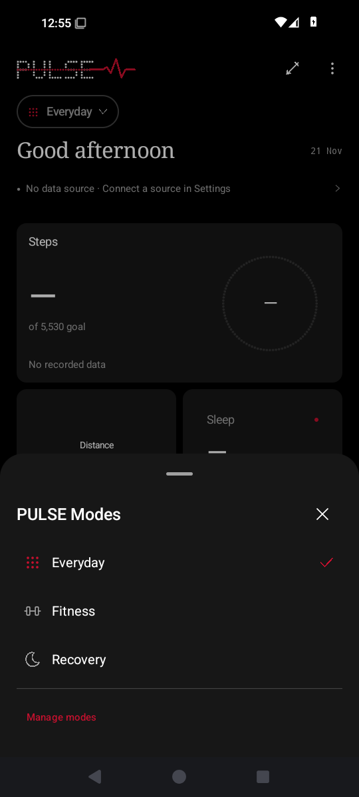

<div align="center">
  
  <h1>PULSE</h1>
  <p><strong>Your health. Your way.</strong></p>
  <p>A customizable Android health dashboard built around your data, your goals and your daily routine.</p>
  
  
  
</div>

## Find your rhythm

| | |
| --- | --- |
| **Modular dashboard** | Arrange, resize and configure the widgets you want in PULSE Studio. |
| **PULSE Modes** | Save dashboard layouts for different parts of your day and switch between them. |
| **History** | Explore daily and longer-term trends in dot-based charts and open detailed records where available. |
| **Goals** | Set personal targets for the health metrics available from your source. |
| **Challenges** | Create manual or health-tracked challenges and follow their progress. |
| **Achievements** | Earn badges and monthly step medals as you make progress. |
| **Health Connect** | Read supported Android health measurements with the permissions you choose. |
| **Privacy** | Your health records stay under your control. PULSE processes them on your device. |

## Screenshots

<div align="center">
  
  
  
</div>

These are Android emulator captures with health providers disconnected. The [full gallery](docs/screenshots/README.md) includes Goals, Challenges, Achievements and widget customization.

## Health integrations

**Health Connect** reads supported records where Health Connect is available. Metrics depend on the records and permissions available on your device.

**Garmin Personal API** is an optional connection for people with their own Garmin Personal API key. PULSE connects directly to Garmin over HTTPS.

**Google Health · Coming soon.** Sync is paused pending verification. Existing local imports stay on the device.

## Your data belongs to you

PULSE has no developer-hosted health-record service. It processes measurements locally and uses no ads, advertising profiles or hidden analytics. Android manages Health Connect permissions. Optional provider access and GitHub update checks contact their respective services. Exporting data or sharing a medal uses Android's share sheet.

## Install and update

The first signed public APK is pending. Once available, use the APK from the repository's Releases tab on Android 9 or later. Compare the APK's SHA-256 with the value in the release's checksum file before opening it. Android may ask you to allow installs from the app you used to open the APK.

In an official GitHub build, open **More options → Check for updates**. PULSE checks stable releases for a higher Android build number and verifies the download's SHA-256, package identity, Android compatibility and signing certificate. You approve installation in Android. A build distributed through Google Play uses Google Play's update flow.

Updates require the same signing identity as the installed APK. See [release and migration instructions](docs/RELEASING.md) if you already use a development build.

## Build from source

Install JDK 17 or a compatible newer version, Android SDK platform 37 and Android build tools 37.0.0. Set your local SDK path in `local.properties` or configure Android Studio. Clone the repository and run the checked-in wrapper.

```bash
./gradlew :app:assembleGithubDebug :app:testGithubDebugUnitTest :app:lintGithubDebug
```

On Windows run `gradlew.bat` with the same tasks. The APK is created in `app/build/outputs/apk/github/debug/`. The `play` flavor builds separately and uses Google Play for updates.

## Architecture

- Kotlin and Jetpack Compose render the dashboard, History, Collection and Settings.
- Room caches provider health records. DataStore holds preferences, dashboard modes and challenge state.
- Health Connect and Garmin adapters map permitted provider data to the PULSE domain model. WorkManager schedules eligible provider refreshes.
- Distribution-specific update integrations select GitHub Releases or Google Play.

Read the [architecture notes](docs/ARCHITECTURE.md) and [data flow review](docs/PRIVACY_REVIEW.md).

## Roadmap

Google Health can return once verification and release requirements are complete. The first public release establishes the signed APK distribution and update path.

## Contributing and security

See the [contribution guide](CONTRIBUTING.md) for local setup and safe test data. Report security concerns privately as described in the [security policy](SECURITY.md).

## Legal, license and credits

- [Privacy Policy](PRIVACY.md) and [Terms of Service](TERMS.md) are included in the app.
- The PULSE source has no project-wide license on file. Public visibility alone does not grant reuse or redistribution rights.
- PULSE uses AndroidX, Jetpack Compose, Kotlin, Room and Health Connect. See [third-party notices](NOTICE.md) for licensing information.
