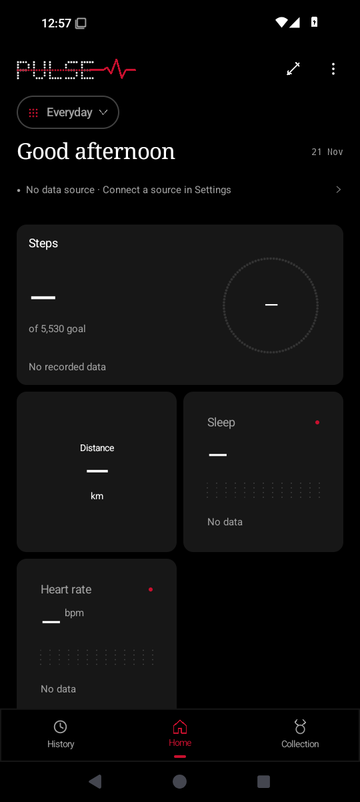
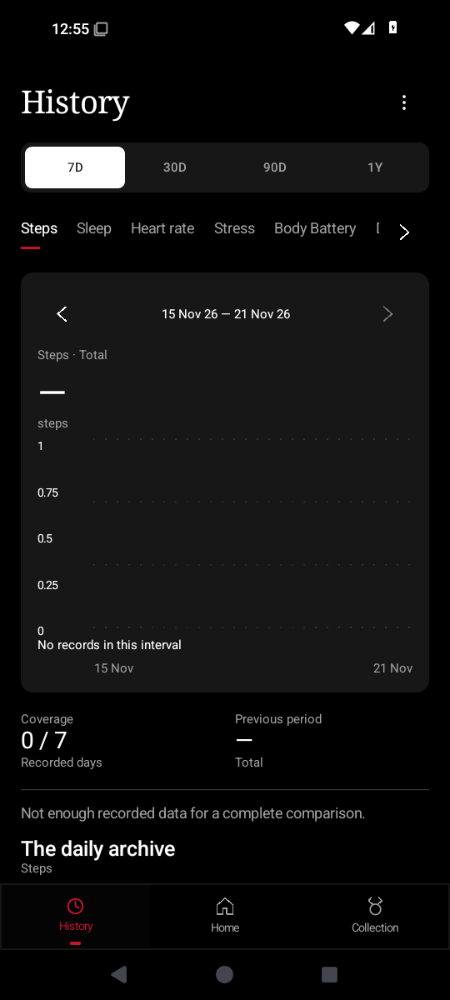

<div align="center">
  
  <h1>PULSE</h1>
  <p><strong>Your health. Your way.</strong></p>
  <p>I built PULSE to make my Android health dashboard feel like mine.</p>
  
  
  
</div>

## Why I built PULSE

I built PULSE because I wanted one place to see my health stats on Android, with a dashboard I could arrange myself. I took inspiration from Nothing’s dot-matrix style for the charts and interface. You can pick the widgets that matter to you and save different layouts for different parts of your day.

## What’s in the app

| | |
| --- | --- |
| **Modular dashboard** | Arrange, resize and configure the widgets you want in PULSE Studio. |
| **PULSE Modes** | Save dashboard layouts for different parts of your day and switch between them. |
| **History** | Explore daily and longer-term trends in dot-based charts and open detailed records where available. |
| **Goals** | Set personal targets for the health metrics available from your source. |
| **Challenges** | Create manual or health-tracked challenges and follow their progress. |
| **Achievements** | Earn badges and monthly step medals as you make progress. |
| **Health Connect** | Read supported Android health measurements with the permissions you choose. |
| **Privacy** | Your health records stay under your control. PULSE processes them on your device. |

## Screenshots

<div align="center">
  
  
  
</div>

I took these screenshots in an Android emulator with health providers disconnected. I put the goals, challenges, achievements and widget editor screenshots in the [full gallery](docs/screenshots/README.md).

## Health integrations

**Health Connect** reads supported records where Health Connect is available. Metrics depend on the records and permissions available on your device.

**Garmin Personal API** is an optional connection for people with their own Garmin Personal API key. PULSE connects directly to Garmin over HTTPS.

**Google Health.** I’ve paused syncing while verification is pending. Health data you already imported stays on your device.

## Your data belongs to you

I wanted your health records to stay under your control, so PULSE processes measurements on your device. I don’t host a health-record service or include ads, advertising profiles or hidden analytics. Android handles Health Connect permissions. Optional integrations and update checks contact their respective services. If you export your data or share a medal, you choose where it goes in Android’s share sheet.

## Install and update

I’m still preparing the first signed public APK. When it’s ready, you’ll find it on the Releases tab. PULSE runs on Android 9 or later. Compare the APK's SHA-256 with the value in the release's checksum file before opening it. Android may ask you to allow installs from the app you used to open the APK.

In an official GitHub build, open **More options → Check for updates**. PULSE checks stable releases for a higher Android build number and verifies the download's SHA-256, package identity, Android compatibility and signing certificate. You approve installation in Android. A build distributed through Google Play uses Google Play's update flow.

Updates require the same signing identity as the installed APK. See [release and migration instructions](docs/RELEASING.md) if you already use a development build.

## Build from source

Install JDK 17 or a compatible newer version, Android SDK platform 37 and Android build tools 37.0.0. Set your local SDK path in `local.properties` or configure Android Studio. Clone the repository and run the checked-in wrapper.

```bash
./gradlew :app:assembleGithubDebug :app:testGithubDebugUnitTest :app:lintGithubDebug
```

On Windows run `gradlew.bat` with the same tasks. The APK is created in `app/build/outputs/apk/github/debug/`. The `play` flavor builds separately and uses Google Play for updates.

## Architecture

- Kotlin and Jetpack Compose render the dashboard, History, Collection and Settings.
- Room caches provider health records. DataStore holds preferences, dashboard modes and challenge state.
- Health Connect and Garmin adapters map permitted provider data to the PULSE domain model. WorkManager schedules eligible provider refreshes.
- Distribution-specific update integrations select GitHub Releases or Google Play.

Read the [architecture notes](docs/ARCHITECTURE.md) and [data flow review](docs/PRIVACY_REVIEW.md).

## Roadmap

I’m working toward a signed APK that I can distribute and update through GitHub. I plan to bring Google Health sync back once verification and the release requirements are complete.

## Contributing and security

If you want to help, I’ve written a [contribution guide](CONTRIBUTING.md) with setup steps and tips for testing with sample data. Please report security concerns privately using the [security policy](SECURITY.md).

## Legal, license and credits

- [Privacy Policy](PRIVACY.md) and [Terms of Service](TERMS.md) are included in the app.
- The PULSE source has no project-wide license on file. Public visibility alone does not grant reuse or redistribution rights.
- PULSE uses AndroidX, Jetpack Compose, Kotlin, Room and Health Connect. See [third-party notices](NOTICE.md) for licensing information.
