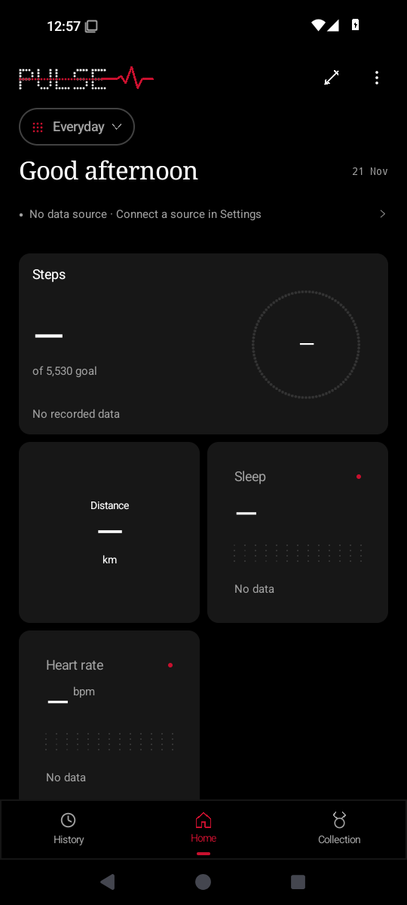
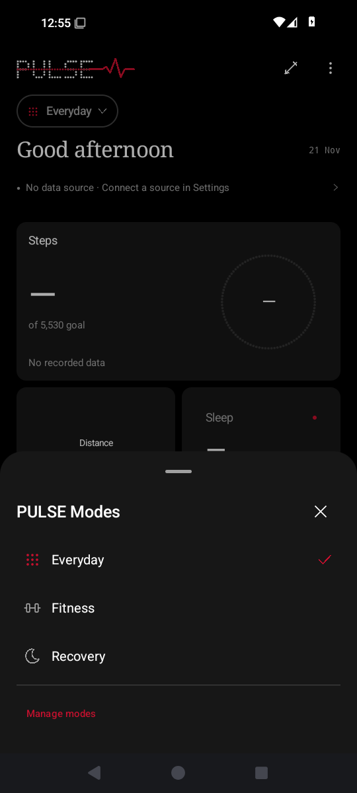
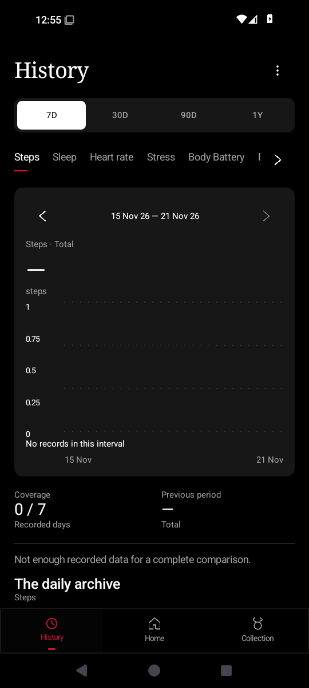
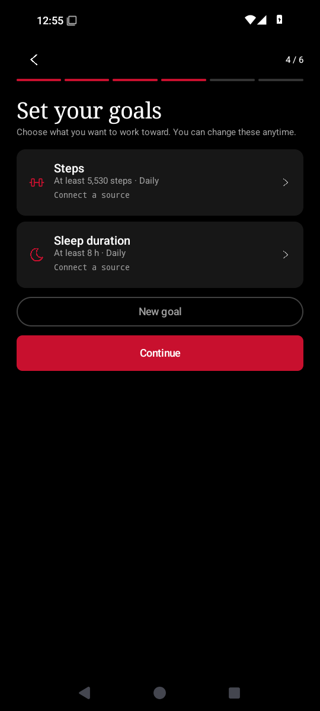
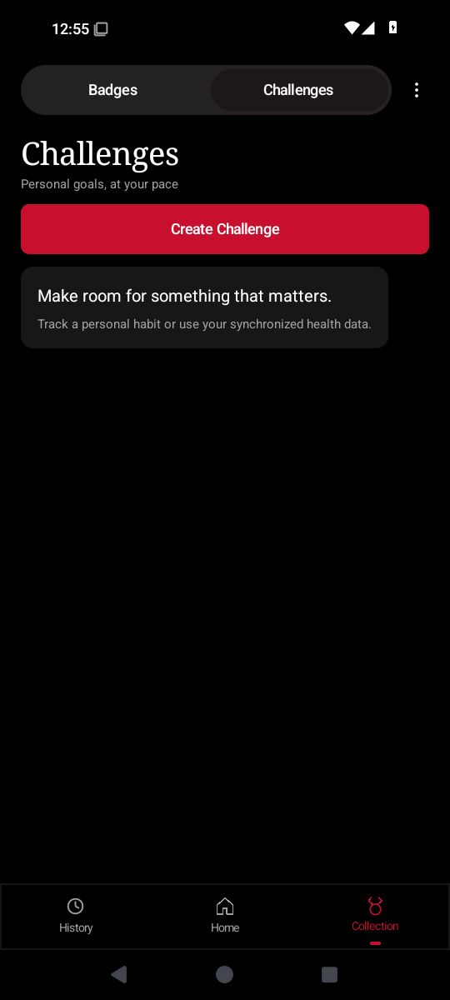
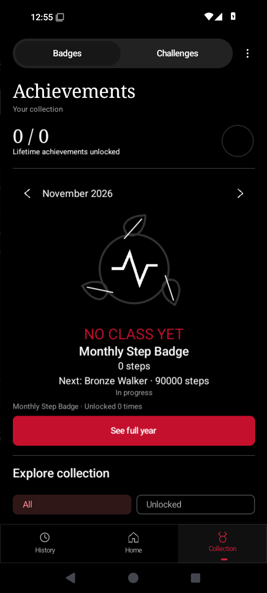
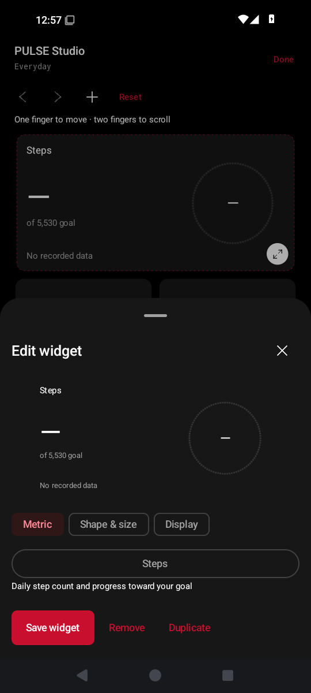

# PULSE in use

These screens were captured on a clean Android 15 emulator without connected health providers or personal records.

| Dashboard | PULSE Modes | History |
| --- | --- | --- |
|  |  |  |

| Goals | Challenges | Achievements |
| --- | --- | --- |
|  |  |  |

| Widget customization |
| --- |
|  |

Capture future screenshots at the same size and inspect them for personal details, system notifications and health records before committing.
